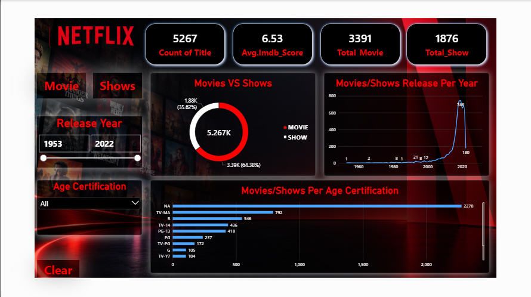

🎬 Netflix Analysis Dashboard | Power BI

📌 Project Overview

The Netflix Analysis Dashboard is an interactive Power BI project designed to analyze Netflix movies and TV shows. It explores content distribution, genres, ratings, countries, and release-year trends to uncover meaningful insights into Netflix's content library.

🎯 Project Objectives

- Analyze the distribution of movies and TV shows
- Identify popular genres and content categories
- Explore content by country and release year
- Analyze ratings and content trends
- Support data-driven insights through interactive visualizations

🛠️ Tools & Technologies

- Power BI
- Microsoft Excel
- DAX
- Power Query

📊 Dashboard Features

Content Distribution: Compare the number of movies and TV shows.

Genre Analysis: Explore content categories and popular genres.

Country Analysis: Examine Netflix content across countries.

Release-Year Trends: Analyze content by release year.

Ratings Analysis: Understand the distribution of content ratings.

Interactive Exploration: Use filters and slicers to explore the data.

KPI Cards & Charts: Present key metrics in a clear, visual format.

📂 Dataset Description

The dataset contains information about Netflix titles, including:

- Show ID
- Title
- Type (Movie or TV Show)
- Director and Cast
- Country
- Date Added
- Release Year
- Rating
- Duration
- Listed-in (Genres)
- Description

🖼️ Dashboard Preview

<!-- Replace the image path below with your actual screenshot path -->

  

  <em>Netflix Analysis Dashboard built using Microsoft Power BI</em>

💡 Skills Demonstrated

- Data Cleaning
- Data Transformation
- Data Visualization
- Power Query
- DAX
- Business Intelligence
- Dashboard Design

🚀 Key Takeaway

This project demonstrates how Power BI can transform raw entertainment data into an interactive dashboard, making it easier to explore content distribution, ratings, genres, and historical trends.